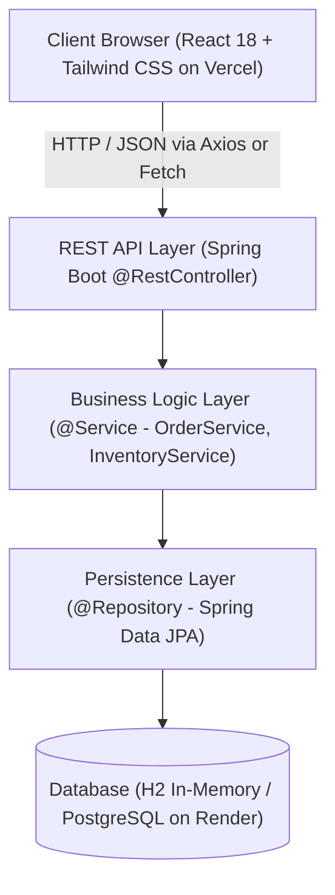

# 🎓 Complete Viva & Project Defense Guide: "All in a Go"

**Project Title:** All in a Go — Multi-Inventory Management System  
**Tech Stack:** Java 21, Spring Boot 3, Spring Data JPA / Hibernate, H2 Database (PostgreSQL Ready), React 18, Tailwind CSS, Vite.  
**Target Deployment:** Backend on **Render**, Frontend on **Vercel**.  

---

## 1. Project Overview & Problem Statement
Traditional eCommerce and inventory systems operate out of a single centralized warehouse with unified shipping. However, modern platforms support **multiple third-party vendors**, each storing their own goods in distributed warehouses across India.

**"All in a Go" solves two major challenges:**
1. **Multi-Vendor Order Splitting (`Order_Splits`):** When a customer purchases items from multiple distinct sellers in a single checkout, the backend automatically partitions the order into isolated vendor fulfillments with independent parcel tracking codes.
2. **Automated Low-Stock Warning System (Core USP):** The system continuously monitors `qty_on_hand` against a configured `safety_stock` buffer for each SKU. When `qty_on_hand <= safety_stock`, an automated low-stock alert is raised in the Vendor Portal with shortfall metrics and a 1-click quick-restock facility.

---

## 2. 3-Tier Layered Architecture

- **Presentation Tier (Frontend):** React Single Page Application (SPA), styled with Tailwind CSS, bundled with Vite. Deployed to Vercel.
- **Application Tier (Backend):** Java 21 REST API using Spring Boot. Implements Controller-Service-Repository architecture pattern. Deployed to Render.
- **Data Tier (Database):** Object-Relational Mapping (ORM) via Hibernate/JPA. Uses H2 in-memory DB for local development and PostgreSQL for production.

---

## 3. Database Schema (The 6 College Tables)

### Table 1: `vendors`
Stores registered marketplace sellers.
- `vendor_id` (Primary Key, Auto-increment)
- `name` (String, Seller name)
- `status` (String: ACTIVE, SUSPENDED, PENDING)
- `commission_rate` (Double: e.g. 8.0 for 8%)
- `api_key_hash` (String: Vendor API authentication token)
- `email`, `password`, `contact_phone`

### Table 2: `warehouses`
Physical logistics depots across India.
- `warehouse_id` (Primary Key)
- `vendor_id` (Foreign Key referencing `vendors`)
- `location_name` (e.g., "Mumbai Central Logistics Hub", "Bengaluru Tech Depot")
- `address` (Full postal address)
- `is_marketplace_owned` (Boolean: true if platform-managed, false if vendor's own facility)

### Table 3: `products`
Parent product catalog entries.
- `product_id` (Primary Key)
- `vendor_id` (Foreign Key referencing `vendors`)
- `title` (Product title)
- `brand` (Brand name)
- `global_sku` (Universal SKU identifier, unique)
- `tax_class` (e.g. "GST_18", "GST_12", "GST_5")
- `category` (Home, Living & Lifestyle | Apparel, Fashion & Accessories | Electronics & Gadgets | Hobbies, Toys & Entertainment)
- `description`, `image_url`

### Table 4: `product_variants`
Specific SKUs, pricing (₹100 to ₹2,000), barcodes, and attributes.
- `variant_id` (Primary Key)
- `product_id` (Foreign Key referencing `products`)
- `vendor_sku` (Vendor's internal SKU)
- `barcode` (Barcode sequence)
- `attributes_json` (JSON string, e.g. `{"color": "Indigo", "size": "32"}`)
- `price` (Double, Indian pricing between ₹100 and ₹2,000)

### Table 5: `inventory_levels`
The core inventory ledger tracking stock per warehouse.
- `inventory_id` (Primary Key)
- `variant_id` (Foreign Key referencing `product_variants`)
- `warehouse_id` (Foreign Key referencing `warehouses`)
- `qty_on_hand` (Integer: Physical stock on shelves)
- `qty_reserved` (Integer: Stock held during active carts)
- `qty_allocated` (Integer: Stock committed to confirmed shipments)
- `safety_stock` (Integer: Minimum threshold before triggering low-stock alert)

### Table 6: `order_splits`
Vendor-specific order partitions.
- `split_id` (Primary Key)
- `parent_order_id` (Foreign Key referencing parent `orders`)
- `vendor_id` (Foreign Key referencing `vendors`)
- `subtotal` (Double: Total for this vendor's items)
- `shipping_status` (CONFIRMED, PACKED, SHIPPED, OUT_FOR_DELIVERY, DELIVERED)
- `tracking_number` (Unique tracking identifier, e.g. `AG-V1-984210`)
- `carrier` (e.g. BlueDart Express, Delhivery)
- `estimated_delivery` (String / Date)

---

## 4. Top 20 College Viva Questions & Answers

### Q1: What is the main difference between Spring and Spring Boot?
**Answer:** Spring Framework requires extensive manual configuration (XML or annotations) and external web server setup (like Apache Tomcat). Spring Boot eliminates this boilerplate through **Auto-Configuration**, **Starter POMs**, and an **Embedded Tomcat Server**, enabling instant "just-run" deployment.

### Q2: How does the Low-Stock Warning algorithm work?
**Answer:** In `InventoryService.java`, we execute the query `SELECT i FROM InventoryLevel i WHERE i.qtyOnHand <= i.safetyStock`. Whenever physical inventory drops to or below the safety threshold, the system flags a `LOW_STOCK_WARNING` or `CRITICAL_OUT_OF_STOCK` (if qty is 0). In the Vendor Portal, vendors see real-time alert cards with the exact unit shortfall and can execute a 1-click Quick Restock (+15 units) via `POST /api/inventory/{id}/restock`.

### Q3: What happens behind the scenes when a customer places an order?
**Answer:** The request hits `OrderController.createOrder()` &rarr; delegates to `OrderService.createOrder()`:
1. Validates stock availability in `inventory_levels`.
2. Groups all cart items by `vendorId`.
3. Persists a master `Order` (parent order).
4. Iterates through each vendor group and creates an `OrderSplit` with a unique tracking number (`AG-V<vendorId>-<timestamp>`).
5. Saves `OrderItem` records linked to both `parentOrderId` and `splitId`.
6. Decrements `qtyOnHand` and increments `qtyAllocated` in `inventory_levels`.

### Q4: What is the difference between `qty_on_hand`, `qty_reserved`, and `qty_allocated`?
**Answer:**
- `qty_on_hand`: Total physical goods stored in the warehouse.
- `qty_reserved`: Units temporarily locked during checkout to prevent double-booking.
- `qty_allocated`: Units committed to placed orders that are awaiting packing/shipping.
- **Available to Promise (ATP) Stock** = `qty_on_hand - (qty_reserved + qty_allocated)`.

### Q5: What is Spring Data JPA and Hibernate?
**Answer:** JPA (Jakarta Persistence API) is a standard specification for Java Object-Relational Mapping (ORM). **Hibernate** is the implementation provider that translates Java objects into SQL queries. **Spring Data JPA** provides repository interfaces (like `JpaRepository`) that automatically generate boilerplate CRUD methods at runtime without writing raw SQL.

### Q6: Why did you choose H2 database for local development?
**Answer:** H2 is a lightweight, zero-configuration in-memory database that starts inside the Spring Boot JVM. It requires no separate server installation, provides an interactive web console at `http://localhost:8080/h2-console`, and uses standard SQL syntax. For production deployment on Render, changing two lines in `application.properties` seamlessly switches to PostgreSQL.

### Q7: What annotations did you use in Spring Boot and why?
**Answer:**
- `@SpringBootApplication`: Marks the main entry point, enables auto-configuration, component scanning, and property support.
- `@RestController`: Marks a class as a controller that handles HTTP requests and returns JSON responses.
- `@Service`: Marks business logic components.
- `@Repository`: Marks Data Access Objects (DAOs) interfacing with the database.
- `@Entity` & `@Table`: Maps Java POJOs directly to database tables.
- `@Transactional`: Guarantees atomic database operations (all steps succeed or rollback on error).
- `@CrossOrigin`: Configures Cross-Origin Resource Sharing for frontend-backend communication.

### Q8: How is the React frontend deployed on Vercel and backend on Render?
**Answer:**
- **Frontend (Vercel):** Single Page Application bundled via Vite (`npm run build`). Vercel serves the static HTML/JS/CSS on global edge CDNs.
- **Backend (Render):** Packaged as a standalone runnable JAR via Maven (`./mvnw clean package`). Render runs it using the Java 21 runtime and exposes the REST endpoints over HTTPS.

---

## 5. Live Demonstration Guide for Teachers & Examiners
1. **Show Catalog & Price Filter:** Demonstrate products strictly categorized into the 4 college categories with Indian prices between ₹100 and ₹2,000.
2. **Demonstrate Low Stock Warning (USP):** Switch to the Vendor Portal. Point out the **Low-Stock Warning Center** highlighting understocked items (e.g. Velvet Curtains, Denim Jeans). Click **Quick Restock (+15 units)** to show real-time replenishing!
3. **Demonstrate Multi-Vendor Order Splitting:**
   - Add items from two different vendors (e.g. Rug from Apex + T-Shirt from Urban Trendz) into the cart.
   - Open Cart: Show the **Multi-Vendor Order Notice** explaining the automatic split.
   - Click Checkout: Complete order.
   - Show Order Success Modal: Point out that **2 distinct Order_Splits** were created with unique tracking numbers!
4. **Demonstrate Live Order Tracking:** Click **Track Parcel** to show the real-time timeline (Confirmed &rarr; Packed &rarr; Shipped &rarr; Delivered).
5. **Show Database Console:** Open `http://localhost:8080/h2-console` (JDBC URL: `jdbc:h2:mem:allinagodb`) and run `SELECT * FROM ORDER_SPLITS;` to show examiner the relational tables.
